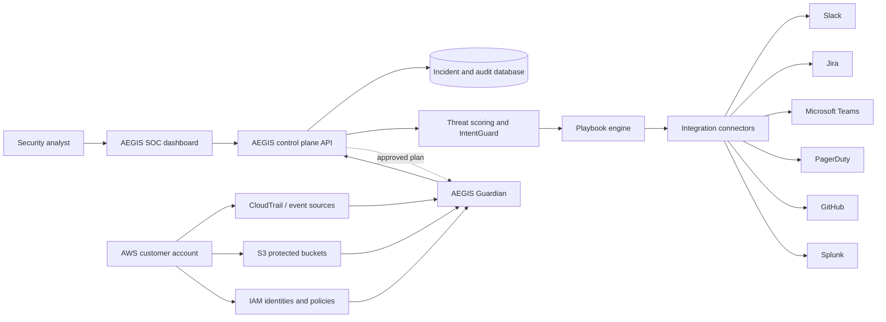
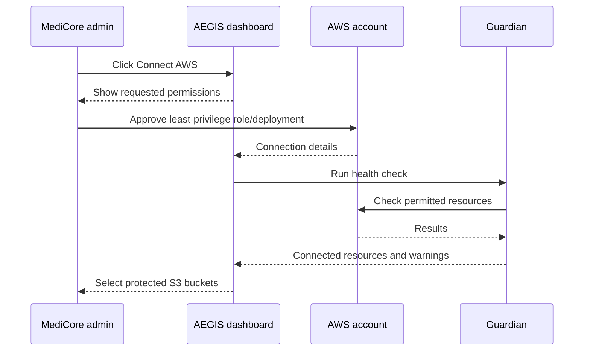
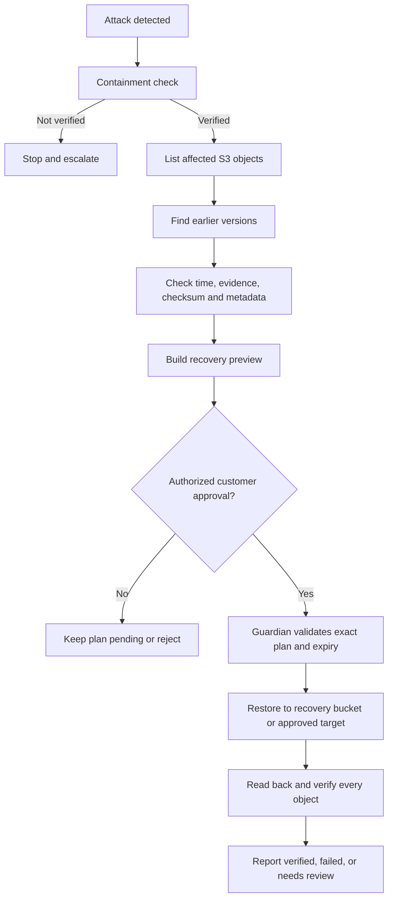
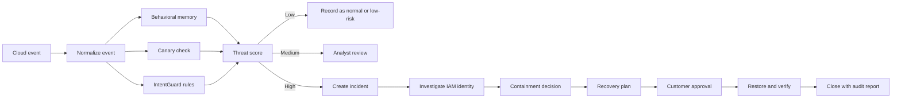
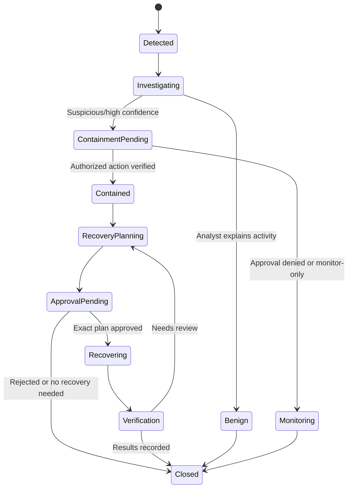
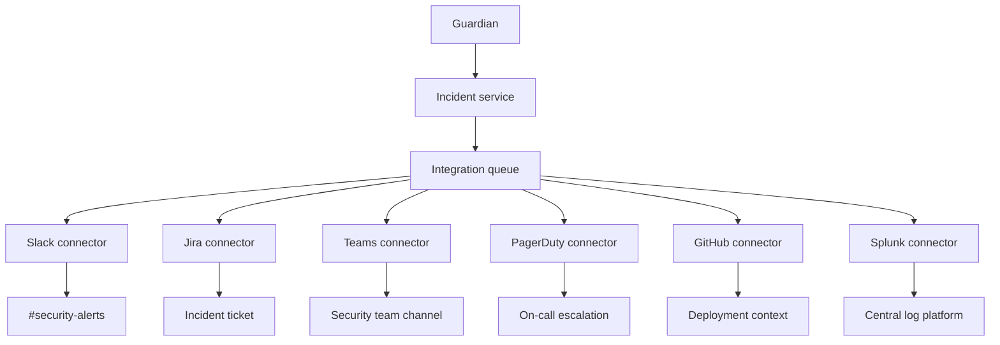

# AEGIS — Cloud Ransomware Defense and Security Operations Platform

> **Purpose of this document:** explain the proposed AEGIS product in very simple language, using one fictional customer—**MediCore Hospital**—as the running example.

## 1. AEGIS in one sentence

AEGIS watches a customer's AWS environment, notices ransomware-like behavior, helps the security team investigate and contain it, and safely helps recover damaged files.

Imagine MediCore Hospital stores synthetic patient reports in Amazon S3. AEGIS is the security layer placed beside the hospital's existing application. The hospital does not need to rewrite its application to use AEGIS.

## 2. Status vocabulary

This document describes the product design, not a claim that every feature already exists in this repository.

- **Proposed:** product behavior we want AEGIS to provide.
- **MVP / hackathon target:** the smallest demonstrable version we should implement first.
- **Future:** valuable follow-up work that should not be promised as part of the first demo.
- **Limitation:** a safety, integration, or AWS constraint that must be shown honestly.

Unless a later implementation note says otherwise, the features below are **proposed**.

## 3. The customer story: MediCore Hospital

MediCore is fictional and uses only synthetic data.

| Hospital system | AWS service | What it does |
|---|---|---|
| Hospital web application | EC2 | Runs the Node.js backend and demo interface |
| Patient database | RDS PostgreSQL | Stores fake patients and report metadata |
| Patient reports | S3 | Stores synthetic PDFs and images; main MVP protection target |
| Staff and application permissions | IAM | Controls who can access AWS resources |
| Security monitoring | CloudTrail and CloudWatch | Provides audit events and operational logs |
| AEGIS Guardian | Lambda and/or customer-side components | Receives events and performs narrowly scoped checks/actions |

The hospital application and AEGIS should be separate projects. That proves AEGIS can protect an existing customer instead of requiring the customer to rebuild its software.

## 4. Product pillars

1. **Connect:** connect an AWS account or selected resources safely.
2. **Monitor:** record file activity and security-relevant events.
3. **Understand:** recognize ransomware patterns and unusual intent.
4. **Protect:** investigate identities and contain high-confidence threats.
5. **Recover:** prepare, approve, execute, and verify safe S3 version recovery.
6. **Coordinate:** notify existing tools and run response playbooks.
7. **Manage:** provide dashboards, roles, posture checks, and audit trails.

## 5. AWS integration architecture

AEGIS has two important sides:

- **AEGIS control plane:** dashboard, incident database, scoring, playbooks, integrations, and audit records.
- **Customer-side Guardian:** a small, restricted component in or near the customer's AWS account. It reads the events it is allowed to read and performs customer-approved actions.

### Proposed AWS connection experience

1. The MediCore administrator clicks **Connect AWS**.
2. AEGIS shows the exact permissions it requests.
3. The administrator creates or approves a least-privilege role or deployment.
4. AEGIS runs a connection test.
5. The administrator selects which S3 buckets are protected.
6. AEGIS reports what is connected and what still needs setup.

## 6. Monitor: file activity and canaries

### File activity monitoring

AEGIS records useful facts such as:

- which bucket and object changed;
- what action happened, such as upload, overwrite, delete, or restore;
- when it happened;
- which AWS identity performed it;
- the event source and evidence reference.

Example: a normal 9:00 AM upload of a new report is different from an unfamiliar role overwriting 500 existing reports at 3:00 AM.

### Canary files

A **canary** is a harmless decoy file placed in a protected location. Normal hospital software should never modify it. If ransomware changes it, AEGIS receives a strong warning signal.

Example canary: `aegis-canary/medicore-do-not-touch.txt`. It contains no patient information.

Canaries are an early-warning signal, not proof by themselves. A legitimate administrator or test could touch one, so the event must be combined with other evidence.

## 7. Ransomware behavior analysis

Ransomware usually creates a pattern, not just one strange event. AEGIS looks for combinations such as:

- many overwrites or deletes in a short time;
- existing files changing instead of only new files appearing;
- file sizes or content fingerprints changing unusually;
- a canary being modified;
- activity at an unusual time;
- a rarely used or newly seen identity;
- an identity doing something its normal job does not require.

The MVP can use transparent rules and recent activity history. It does not need to claim that it understands every possible attack or use mysterious AI.

### Behavioral memory

Behavioral memory means keeping a history of what “normal” looks like for a bucket, identity, and application.

Example:

- Normal: `report-service` creates about 200 new reports between 8:00 and 10:00 every weekday.
- Suspicious: the same role overwrites 200 old reports at 3:00 AM and changes the canary.

The memory must be explainable and adjustable. A baseline should never silently block a hospital operation.

## 8. IntentGuard

**IntentGuard checks whether an identity is doing the job the customer intended it to do.**

MediCore might define this simple rule:

> The report-upload service may create new reports in the reports bucket. It may not delete old reports or modify the canary folder.

IntentGuard compares observed actions with customer-defined expectations:

| Rule part | Example |
|---|---|
| Identity | `medicore-report-service-role` |
| Allowed action | Put new object |
| Restricted action | Delete or overwrite existing object |
| Resource | `s3://medicore-patient-reports/*` |
| Schedule | Weekdays, 08:00–18:00 |
| Response | Alert, approval, or narrowly scoped containment |

IntentGuard does not read an application's mind. It enforces understandable rules that the customer creates and reviews.

## 9. Threat scoring

AEGIS combines evidence into a score so analysts can prioritize. A score is an explanation aid, not a statement of certainty.

Illustrative signals:

| Signal | Example points |
|---|---:|
| Canary modified | +30 |
| Large overwrite burst | +25 |
| Unusual time | +10 |
| New or rare identity | +10 |
| IntentGuard violation | +15 |
| Confirmed normal maintenance window | −20 |

The exact numbers are proposed and must be tested against legitimate workloads. The dashboard should show *why* the score is high.

## 10. IAM investigation

When an alert is created, AEGIS builds an investigation view:

- implicated role, user, or session where available;
- affected bucket and objects;
- event timeline;
- relevant CloudTrail evidence reference;
- recent policy or deployment context;
- confidence and unknowns.

AEGIS must not claim to know the real human attacker from an AWS identity alone. It reports the identity evidence that AWS provides.

## 11. Customer-controlled containment

Containment means stopping further harmful changes. It is dangerous if done too broadly, so MediCore remains in control.

| Protection mode | Behavior |
|---|---|
| Monitor only | Alert and collect evidence; change nothing |
| Approval required | Recommend a specific action and wait for an authorized approver |
| Automatic protection | Apply only a pre-approved, narrowly scoped action when conditions match |

Possible action: temporarily restrict writes from a dedicated compromised test role. AEGIS should not automatically disable a shared role that powers patient services.

The Guardian should independently validate the incident, target, scope, expiry, and authorization. A dashboard message alone must not be enough to make a high-impact AWS change.

## 12. Safe S3 version recovery

### The simple explanation

S3 Versioning keeps older copies of an object. If ransomware replaces `patient-report-001.pdf`, AEGIS can propose copying an earlier version back as the current version—provided a clean, usable version exists.

### Recovery workflow

### What the approval contains

The approval should identify the exact:

- incident;
- bucket and object keys;
- source version IDs;
- destination and recovery mode;
- approver identity and role;
- approval time and expiry;
- expected number of objects.

For sensitive workloads, two-person approval is a future option. The safest default is to restore to a separate recovery bucket first, inspect the files, and then perform a controlled cutover.

### Verification

AEGIS should not say “success” because an S3 copy request was accepted. It should verify that:

1. the approved source version still exists;
2. the object did not change unexpectedly while awaiting approval;
3. the copy completed;
4. the resulting object can be read;
5. a trusted checksum or hash matches where available;
6. encryption, metadata, and tags meet the recovery policy;
7. each object has its own result.

### Recovery limitations

- Versioning must have been enabled before the damaging overwrite.
- Retention rules may have removed the needed version.
- An older version is not automatically guaranteed to be clean.
- S3 recovery cannot restore data that was never versioned or backed up.
- Concurrent writes require a maintenance window, controlled permissions, or staging/cutover; a simple pre-check is not a complete race-condition defense.
- Production recovery must handle encryption, metadata, tags, large objects, retries, and partial failures.

## 13. Complete event and incident flow

### Incident lifecycle

## 14. SOC dashboard

The dashboard should answer “What is happening?”, “Why do we believe it?”, and “What can I safely do next?”

| Page | Beginner-friendly purpose |
|---|---|
| Overview | Overall protection status and urgent incidents |
| Cloud assets | Connected AWS accounts, buckets, and coverage |
| Live activity | Recent file and identity actions |
| Incidents | Open, acknowledged, contained, and closed incidents |
| Investigation | Evidence, timeline, identity, and affected resources |
| Recovery Center | Candidate versions, approvals, progress, and verification |
| Playbooks | Response workflows and their approval steps |
| Integrations | Connection status and delivery failures |
| Security posture | Missing versioning, risky permissions, and configuration warnings |
| Audit trail | Who viewed, changed, approved, or executed an action |
| Reports | Incident and recovery summaries |

## 15. Role-based access and audit trails

Suggested roles:

| Role | Can do |
|---|---|
| Viewer | Read dashboards and reports |
| Analyst | Investigate, acknowledge, and classify incidents |
| Responder | Request or execute permitted containment playbooks |
| Recovery approver | Approve exact recovery plans |
| Administrator | Manage users, policies, connections, and integrations |
| Auditor | Read immutable audit history and export reports |

Every important action should record who did it, what changed, when, the target, the reason, and the result. Audit logs should be append-only or protected so ordinary administrators cannot silently rewrite history.

## 16. Integrations

AEGIS should emit one standard incident event and let separate connectors deliver it to external tools.

| Integration | Proposed use | Safety boundary |
|---|---|---|
| Slack | Post concise alerts and links | Do not send patient content; token gets notification scope only |
| Jira | Create and update incident tickets | Idempotent updates; no AWS control permission |
| Microsoft Teams | Send team notifications | Use approved channel and least privilege |
| PagerDuty | Page on-call responders for critical incidents | Escalation only; avoid alert storms |
| GitHub | Show relevant commits, releases, and deployments as context | Context is not proof of causation |
| Splunk | Forward normalized incidents and evidence references | Protect secrets and avoid duplicate events |

Connectors should use encrypted secrets, retries, deduplication keys, health checks, and an integration audit trail.

## 17. Security playbooks

A playbook is a prepared checklist that AEGIS can follow.

### Ransomware response playbook

1. Detect unusual overwrites and/or a canary change.
2. Create an incident and calculate an explainable score.
3. Notify Slack and create a Jira ticket.
4. Investigate the implicated IAM identity.
5. Request or apply a pre-approved, narrow containment action.
6. Verify containment.
7. Prepare S3 recovery candidates.
8. Ask an authorized customer approver.
9. Restore and verify objects.
10. Update external tools and close with an audit report.

Each step needs a timeout, retry behavior, failure state, and clear human handoff.

## 18. MVP versus future roadmap

### MVP / hackathon demonstration

- Synthetic MediCore Hospital environment.
- S3 Versioning enabled on a demo bucket.
- S3 event ingestion with a clearly documented event-delivery design.
- Canary files.
- Rule-based ransomware behavior detection.
- Basic behavioral history.
- IntentGuard rules for one or two identities.
- Explainable threat score.
- IAM identity and event timeline investigation.
- Monitor-only containment, plus a narrowly scoped approved test-role containment demo.
- Recovery preview, customer approval record, controlled restore, and per-object verification.
- SOC dashboard for assets, activity, incidents, recovery, and audit events.
- Role-based access for viewer, analyst, and administrator.
- One or two integrations, preferably Slack and Jira.
- One end-to-end ransomware response playbook.

### Future releases

- More AWS resource connectors and deeper EC2 runtime visibility.
- RDS-specific database activity monitoring and recovery workflows.
- Teams, PagerDuty, GitHub, and Splunk production-grade connectors.
- Two-person recovery approvals and stronger customer identity federation.
- Immutable external audit storage and compliance reports.
- Better behavioral models tested against many legitimate workloads.
- Multi-account and multi-region management.
- Backup-aware recovery across S3, databases, and other storage.
- Advanced deployment context and threat hunting.
- High-availability, scale, cost controls, and enterprise support features.

## 19. Important limitations and honest claims

### S3 event delivery is not magic

S3 events can be asynchronous and may be delivered more than once or out of order. AEGIS must use event IDs or idempotency keys, tolerate retries, and use an authoritative audit source where the design requires stronger ordering or completeness. The dashboard should say when evidence is delayed or incomplete.

### RDS and EC2 need separate connectors

Monitoring an S3 bucket does not automatically monitor PostgreSQL queries or processes running inside EC2. RDS and EC2 require their own supported telemetry, permissions, and integration design. The product must label these areas as “not configured” rather than implying full coverage.

### Safe permissions are essential

AEGIS should request the smallest permissions possible, separate read and action roles, prefer customer-controlled roles, expire temporary permissions, and show every requested permission. Automatic containment and recovery must be opt-in and narrowly scoped.

### Versioning and backups are prerequisites

Recovery is possible only when an appropriate clean version or backup exists. Enabling Versioning after an incident does not recreate old versions.

### Detection is not certainty

Scores and rules identify suspicious behavior. They do not prove malicious intent. Analysts and customer policies remain important.

## 20. Definition of a successful demo

The strongest demo is a safe, synthetic attack against MediCore:

1. A simulator overwrites synthetic reports and touches the canary.
2. AEGIS receives events and shows the unusual burst.
3. IntentGuard and behavioral memory explain why it is suspicious.
4. The dashboard identifies the test IAM role and affected files.
5. A responder approves narrow containment.
6. AEGIS verifies that writes are restricted.
7. The Recovery Center finds earlier S3 versions.
8. A recovery approver confirms the exact plan.
9. AEGIS restores to a recovery location, verifies every file, and reports failures separately.
10. Slack/Jira receive a concise incident update and the audit trail records the complete story.

The product promise is therefore:

> **AEGIS helps organizations detect ransomware-like cloud behavior, understand what happened, coordinate a response, contain it with customer control, and recover data safely when valid versions or backups exist.**

